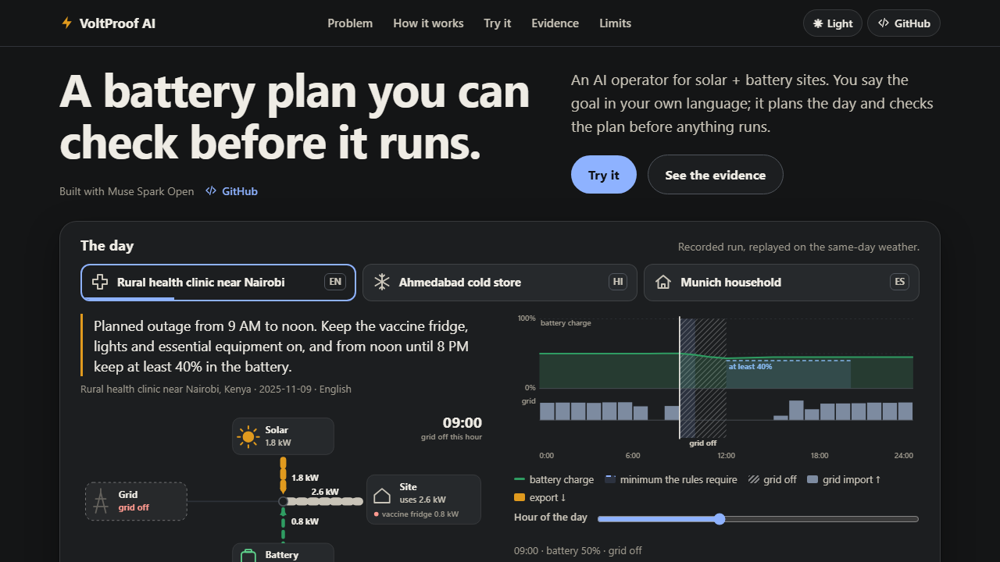
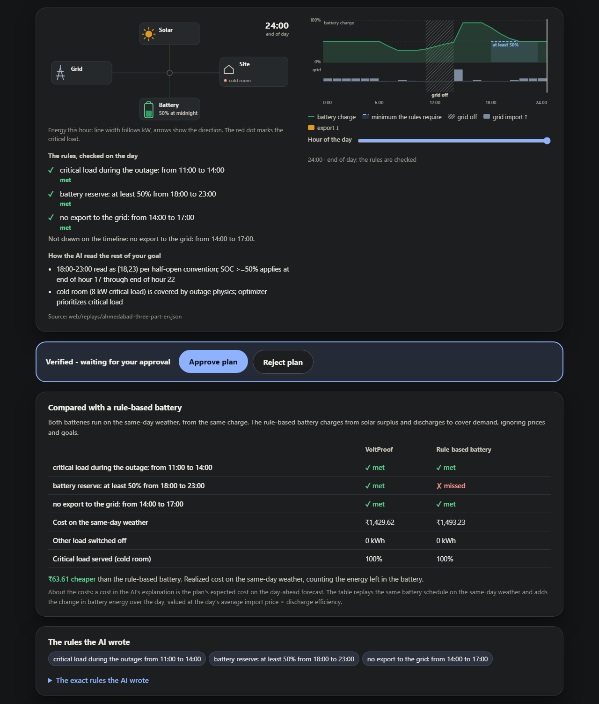
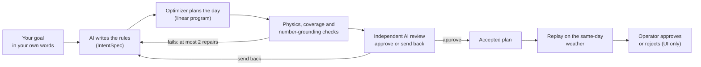
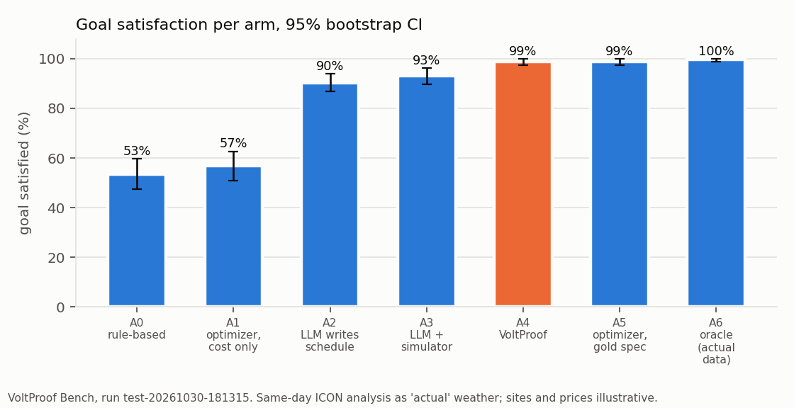
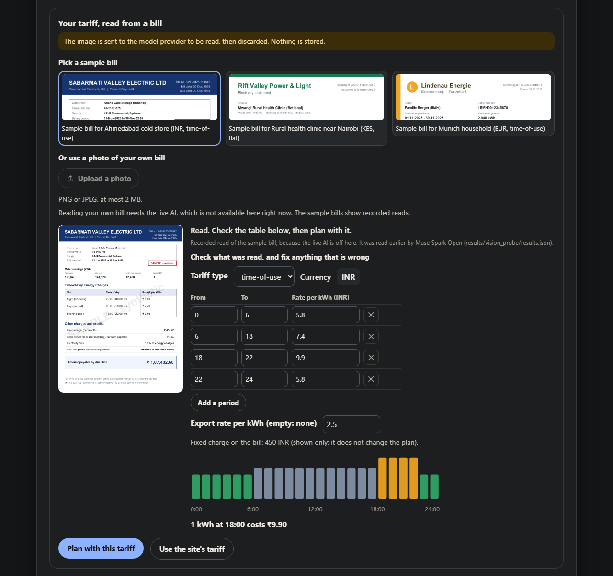

<div align="center">

# ⚡ VoltProof AI

**An AI operator for solar + battery sites. You say the goal in your own language; it plans the day and checks the plan before anything runs.**

[](#run-it-yourself)
[](LICENSE)
[](#models-data-and-credits)
[](#run-it-yourself)

**[Try the live demo](https://huggingface.co/spaces/Swayam14/voltproof)** · **[Watch the demo video](https://www.youtube.com/watch?v=yxoXfdpyZfo)** · **[Results](#results-voltproof-bench)** · **[Run it yourself](#run-it-yourself)**



</div>

Built solo for the **Meta Global AI Developer Hackathon** (Indie track, theme "Push the Frontier", energy). Every line of code in this repository was written during the event, October 27 to November 4, 2026.

## In 30 seconds

A battery at a clinic, a cold store or a home has to be planned around outages, hourly prices and the weather, every day. Asking an AI to write that plan directly sounds easy, but a plan written as text can quietly break physics: charge the battery past full, or count on energy that is not there when the grid goes down.

VoltProof AI splits the job so that **the AI proposes and deterministic tools decide**:

1. You type a goal in plain language (tested in English, Spanish, Hindi, Portuguese and German): *"Planned outage from 9 AM to noon. Keep the vaccine fridge, lights and essential equipment on, and from noon until 8 PM keep at least 40% in the battery."*
2. **Muse Spark Open** turns the goal into a small, checkable list of rules (an *IntentSpec*). It never writes battery setpoints.
3. A **linear-programming optimizer** finds the cheapest 24-hour plan that satisfies the rules.
4. A **physics verifier** and two more deterministic checks must pass before the plan is accepted. Then a second, **independent AI reviewer** can only approve the rules or send them back.
5. The accepted plan is **replayed hour by hour on the same-day weather** and compared with the rule-based battery most sites use today.

On a held-out benchmark of 260 episodes the full system met **98.8%** of goals, against 90.4% when the AI writes the schedule itself. On outage days, **45 of 45** VoltProof plans passed the physics check; only **8 of 45** plans written directly by the AI did.

## Try the demo

The demo is one page; no sign-up. **<https://huggingface.co/spaces/Swayam14/voltproof>**

| Step | What to do |
| --- | --- |
| 1. Watch a recorded run | The top of the page plays a recorded run on the same-day weather, for a rural clinic near Nairobi, a cold store in Ahmedabad and a household in Munich. Drag the hour slider; the diagram shows where every kilowatt goes. |
| 2. Pick a site and a goal | In **Try it**, choose a site and a recorded goal: English, a harder goal, or one in Hindi, Spanish, Portuguese or German. Recorded runs replay a real earlier run of the agent and cost nothing. |
| 3. Type your own goal | Type any goal (500 characters) in any language. The AI runs live; you see the pipeline stages complete one by one. Live runs are rate-limited, and the page says how many you have left. |
| 4. Read the result | The result shows the rules the AI wrote, how it read the rest of your goal (its assumptions), the checks, the day replayed hour by hour, and a comparison with a rule-based battery. |
| 5. Approve or reject | **Approve plan** confirms it: "Approved. In a real deployment the plan would be sent to the site now; this demo sends nothing." **Reject plan** says "Plan rejected. Nothing was sent to the site." and opens an optional note box (200 characters). **Plan again with this note** adds your note to the goal, shows the combined text in the goal box and starts a normal live run on the same site, day and tariff, using one of your live runs. **Edit the goal** and **Undo** are there too. Approve and reject are interface steps only: they send and store nothing, and no device is controlled. |
| 6. Read a bill | **Use your own tariff from a bill**: pick one of three synthetic sample bills or upload a photo. The AI reads the prices, you confirm or fix the table, and the plan and the comparison use your tariff. Planning with a bill's tariff always needs a live run. |

If live runs are not available (limits, budget, or the model key has expired), the page says why and offers the recorded goals. If a live run is refused or fails after you press the button, the page plays a recorded run for that site and labels it as recorded; it never pretends.



## How it works



- **The AI writes rules, not numbers.** The IntentSpec is a short, language-independent JSON document with fields such as grid outages, reserve windows, state-of-charge targets, import caps and no-export windows. Every spec is validated, and all errors are returned to the agent at once.
- **The optimizer decides the plan.** A linear program (SciPy, HiGHS) with a fixed priority order: critical load, then other load, then the goals, then saving cycles, then money. The penalty weights are set so that it does not shed load to honour a preference and does not break a goal to save money. It solves in a few milliseconds.
- **The agent cannot skip the gate.** The only way to finish is `finalize`, which runs four checks in order: (1) the plan is physically valid and every shortfall is stated; (2) every item of the agent's own checklist maps to a rule or a stated assumption; (3) every number in the explanation comes from a tool result, the goal or the spec; (4) an independent AI reviewer, which sees only the goal, a site summary, the rules and the agent's assumptions, approves them. Failed checks go back to the agent with exact reasons, for at most two repair rounds. After that, a plan that still fails check 1 or 2 is escalated to an operator instead of guessing; a plan that passes both but still fails check 3 or 4 is accepted with a recorded flag. In the 260-episode benchmark this last step never happened: 0 escalations and 0 flags.
- **Numbers reach the battery only through the optimizer.** The accepted plan is always read from the plan log, never from the model's prose.
- **The replay is honest.** The plan is made on a day-ahead forecast and executed on the same-day weather analysis, hour by hour, with one set of execution rules shared by every approach being compared.

Example: the rules the agent wrote for the clinic goal above, from a recorded run ([`web/replays/nairobi-outage-reserve-en.json`](web/replays/nairobi-outage-reserve-en.json)):

```json
{
  "grid_outages": [
    { "start_hour": 9, "end_hour": 12 }
  ],
  "reserve_windows": [
    { "start_hour": 12, "end_hour": 20, "min_soc_pct": 40.0 }
  ],
  "assumptions": [
    "'noon' read as 12:00",
    "'8 PM' read as 20:00, window [12,20)"
  ]
}
```

## Results (VoltProof Bench)

VoltProof Bench is the evaluation harness. It compares seven approaches (A0 to A6) on the same episodes: **260 episodes** (170 English goals over 15 test days on 3 sites on 3 continents, plus 90 goals in 5 languages), with **one site (Munich) held out**: it appears in no prompt, example, development run or pilot. The code, prompts and goals were frozen before the test run (git tag `test-freeze`, commit `2dacaa5`, code fingerprint `79958a98d7cc9d2291a3d57390fef973a9e76a9ed141acddc58a8a66efd5f5eb`). The only later change to the frozen code is an additive executor flag used by the E1 counterfactual below, with the frozen behaviour as its default; a regression check over all 1,820 results passed, and the fingerprint is now `20abe8704fc57c9aa9132bf53e7da21c2023985f3a00a3ccc5c8813f6e48f55a`. Every number below comes from the committed runs in [`results/`](results/). [How the benchmark works](#how-the-benchmark-works) explains the method.

### Goals met, by approach

| Approach | What it is | Goals met |
| --- | --- | --- |
| A0 rule-based battery | charges from solar surplus, discharges to cover demand; ignores prices and goals | 53.5% (139/260) |
| A1 optimizer, cost only | the optimizer with no knowledge of the goal | 56.9% (148/260) |
| A2 LLM writes the schedule | one AI call returns 24 setpoints | 90.4% (235/260) |
| A3 LLM + simulator | the AI may test its schedule in a simulator before submitting | 93.1% (242/260) |
| **A4 VoltProof** | AI writes rules, optimizer plans, checks gate the plan | **98.8% (257/260)** |
| A5 optimizer + hand-written rules | reference: perfect goal understanding | 98.8% (257/260) |
| A6 oracle | reference: also plans on the same-day weather analysis in advance | 99.6% (259/260) |

A4 is **+8.5 percentage points** better than the AI writing the schedule itself (paired bootstrap 95% interval +5.0 to +11.9, 10,000 resamples). A5 and A6 are references that give the optimizer the hand-written rules (A5) and the same-day weather analysis in advance (A6); they are not real alternatives. A4 matches A5: on this benchmark the model needed no fine-tuning to turn goals into rules.



### Safety on outage days

| Plans that passed the physics check on outage days | Passed |
| --- | --- |
| A2: AI writes the schedule | 8 of 45 (17.8%) |
| A4: VoltProof | 45 of 45 (100%) |

"Passed" means the plan, as written, did not draw from a grid that was down. In our simulation the controller's outage override protects the critical load, so no approach lost any on these 45 episodes except the rule-based battery (0.147 kWh in one episode). With the override removed (the E1 counterfactual, a conservative estimate of what the plans alone would have lost), the AI-written schedules would have lost 12.8 kWh of critical load in 4 episodes and 255 kWh of other load, and VoltProof's plans 9.5 kWh of critical load in 5 episodes and 60 kWh of other load. VoltProof's critical-load losses come from solar falling short of the forecast (the oracle loses none), and in that counterfactual fewer of its goals were met (86.7% against 91.1%), so the override stays as a second layer. See [`results/e1/`](results/e1/).

### Held-out site, languages and harder goals

| Approach | All sites | Ahmedabad | Munich (held out) | Nairobi | Held-out goal templates |
| --- | --- | --- | --- | --- | --- |
| A0 rule-based | 53.5% (139/260) | 44.4% (40/90) | 58.9% (53/90) | 57.5% (46/80) | 40.0% (12/30) |
| A1 optimizer, cost only | 56.9% (148/260) | 28.9% (26/90) | 58.9% (53/90) | 86.2% (69/80) | 53.3% (16/30) |
| A2 LLM writes the schedule | 90.4% (235/260) | 85.6% (77/90) | 93.3% (84/90) | 92.5% (74/80) | 76.7% (23/30) |
| A3 LLM + simulator | 93.1% (242/260) | 92.2% (83/90) | 93.3% (84/90) | 93.8% (75/80) | 76.7% (23/30) |
| **A4 VoltProof** | **98.8% (257/260)** | **97.8% (88/90)** | **100.0% (90/90)** | **98.8% (79/80)** | **90.0% (27/30)** |
| A5 optimizer + hand-written rules | 98.8% (257/260) | 97.8% (88/90) | 100.0% (90/90) | 98.8% (79/80) | 90.0% (27/30) |
| A6 oracle | 99.6% (259/260) | 98.9% (89/90) | 100.0% (90/90) | 100.0% (80/80) | 96.7% (29/30) |

On Munich, the site held out of the development runs, VoltProof met all 90 goals, +6.7 points over the AI writing the schedule (interval +2.2 to +12.2). The 3 goals it missed overall are all on one held-out goal template, `outage_then_reserve`; the hand-written rules (A5) miss exactly the same 3.

- **Goal understanding:** VoltProof's rules matched the hand-written rules exactly in 99.6% of episodes (259/260): 99.4% of the English set (169/170) and 100.0% in each of English, Spanish, Hindi, Portuguese and German (18 goals each, the same goals, days and sites). "Exactly" means every rule item matches, with the same kinds and hours and nothing missing or extra; charge levels count as equal within ±1 percentage point and power within ±0.1 kW.
- **Harder goals** (a separate set of 101 goals with negations, relative times, colloquial times, distractor sentences, compound and impossible goals, reported on its own and never pooled): VoltProof 94.1% (95/101), the AI-writes-schedule approach 88.1% (89/101), a difference of +5.9 points (interval +2.0 to +10.9). All 6 goals VoltProof missed are the physically impossible ones, which no approach can meet; it stated the shortfall in its explanation on all 6, the AI-writes-schedule approach on none. That approach also missed 6 goals with relative times and "tonight". See [`results/e2/REPORT.md`](results/e2/REPORT.md).
- **Independent reviewer stress test:** on 40 episodes with correct rules, then with one deliberate error at a time, and the agent's assumptions present as in the product, the reviewer flagged shifted hours 100% [88, 100], a wrong level 100% [89, 100], an unneeded item 100% [91, 100], a wrong field 97% [86, 100] and a missing item 82% [68, 91]; it raised a false alarm on correct rules 0% [0, 9] (0 of 40). Intervals are 95% Wilson. Without assumptions, missing items rise to 100% [91, 100] and wrong levels fall to 87% [70, 95]: the reviewer counts a requirement the assumptions still describe as not missing. See [`results/e3/REPORT.md`](results/e3/REPORT.md).
- **Reasoning effort:** the AI agent's reasoning effort did not change goal satisfaction (95% at low, medium and high on the same 60 episodes). High cost about 50% more than medium at list prices ($0.0220 against $0.0147 per episode; low was $0.0131) and was slower (median 14.6 s against 9.9 s, indicative only, since the medium runs were measured at another time and concurrency). One sample per setting, so small differences are not effects. The demo and every other result use `medium`. See [`results/e4/REPORT.md`](results/e4/REPORT.md).

### What the money comparison does and does not say

Goals come first in the optimizer, so money is not the headline. Pooled against the rule-based battery, VoltProof saved 0.62% at Ahmedabad and 5.02% at Nairobi.

**At the household site, day-ahead forecast error erased the money advantage.** VoltProof met all 90 goals there but cost 10.06% more than the rule-based battery (median €0.03 more per day, cheaper in 33 episodes and dearer in 57). The oracle, with the same rules and the same-day weather analysis in advance, saved 9.49% (median €0.05 per day, cheaper in 71), so the savings exist with a perfect forecast. In the cost breakdown of VoltProof's gap to the best possible result there, translation from goal to rules accounts for 0.000 points and the forecast for all 1.530.

**During an outage, VoltProof keeps every load on, while the rule-based battery may switch other load off and then look cheaper.** Realized cost does not count load that was switched off. On the Ahmedabad cold store on 2025-12-17, with the grid off 14:00 to 17:00, VoltProof cost ₹2,419.51 with nothing switched off, and the rule-based battery ₹2,097.22 with 41.12 kWh of other load switched off; both met the goal. With that load removed from the day and the plan solved again, VoltProof costs ₹2,027.74, which is ₹69.48 (3.3%) less. This explains 10 of the 36 main-run episodes where both meet every goal and VoltProof costs more; the other 26 are Munich, by €0.01 to €0.64. The demo says so when it happens. See [`results/notes/shed_load.md`](results/notes/shed_load.md).

Statistics: results are reported with paired bootstrap 95% confidence intervals (10,000 resamples, seed 2026), and per-episode percentages are never averaged (they are unstable when the rule-based cost is near zero). Weather is the same-day model analysis, not a measurement; see [Limitations](#limitations).

## How the benchmark works

- **Sites and days.** Three illustrative sites: a cold store in Ahmedabad (time-of-use tariff, INR), a rural clinic near Nairobi (flat tariff, KES) and a household in Munich (hourly tariff, EUR). Each has 5 seeded test days, 15 in all, kept apart from the development days. Munich appears only in the test set ([`data/splits.json`](data/splits.json)).
- **Goals.** 12 goal templates, 2 of them held out of development. The English set is every test day times every template that applies to the site, 170 episodes. The multilingual set is 6 goals on one test day per site in 5 languages, 90 episodes, so each language is compared on the same goal, day and site. Every episode was written to [`results/test-run/episodes_plan.json`](results/test-run/episodes_plan.json), with its hand-written gold rules, before the run started.
- **Same conditions for every approach.** Every episode runs all 7 approaches, 1,820 results with 0 infrastructure errors. Plans are made on the day-ahead forecast and executed by one shared executor on the same-day weather analysis, starting from the same battery charge.
- **What is scored.**
  - *Goal met:* the hand-written rules hold on the executed day.
  - *Plan physics valid:* the plan, as written, does not need a grid that is down.
  - *Exact rule match:* the agent's rules equal the hand-written ones within the tolerances above.
  - *Realized cost:* grid purchases minus export income, plus battery wear, plus the value of the change in stored energy, priced at the day's mean import price times discharge efficiency. Unserved load is not in it.
  - *Total cost:* realized cost plus the penalties for unserved load, curtailed solar and missed goals.
- **How numbers are combined.** Money is per site and never summed across currencies: a pooled ratio against the rule-based battery, the median daily difference and paired win, loss and tie counts. VoltProof's gap to the best possible result is split into translation (A4 minus A5), forecast (A5 minus A6) and a remainder.
- **Separate experiments, never pooled.** E1 removes the outage override ([`results/e1/`](results/e1/)), E2 is the harder goal set ([`results/e2/`](results/e2/)), E3 stress-tests the reviewer ([`results/e3/`](results/e3/)) and E4 sweeps reasoning effort ([`results/e4/`](results/e4/)).

The full tables are in [`results/report/REPORT.md`](results/report/REPORT.md), and the frozen run with its fingerprints and every agent trace is in [`results/test-run/`](results/test-run/README.md). The run cost $21.50 in model calls by the ledger.

## Bill reader

Prices come from a photo of a bill, read by Muse Spark Open. The design is **read, then confirm**: the AI proposes a table, deterministic checks block anything impossible (a different currency, hours that do not cover exactly 24, gaps or overlaps, half-hour slots, non-positive rates), and **the user confirms or fixes every number** before a plan is made. The planner itself is unchanged: it is given the day with the bill's prices.



- Uploaded images are re-encoded (metadata and GPS removed), capped at 2 MB and 25 megapixels, and sent to the model provider to be read. They are held in memory only, never stored and never logged.
- The sample bills never dead-end: if a live read cannot happen, a sample shows its recorded read and says so. Only an upload is refused, with the reason.
- Evaluation, one pass, synthetic bills drawn by our own code: 6 of 6 read correctly in the first probe; on 10 harder bills (Hindi labels, sideways photo, prices in cents, pale print, many fee lines) 7 of 7 readable bills were read correctly and 3 of 3 unreadable or unsupported bills were refused, at about $0.004 per bill. One bill with half-hour slots was refused for the wrong reason (the model called it unreadable instead of reporting half-hour slots). Real bills have not been tested. See [`results/vision_eval/README.md`](results/vision_eval/README.md).

## Run it yourself

Needs Python 3.10 (and Node.js, only for the 72 web-logic tests, which skip without it). **No API key is needed to run the demo in recorded mode.**

```powershell
# Windows PowerShell
git clone https://github.com/Swayam13-exe/VoltProof.git
cd VoltProof
py -3.10 -m venv .venv
.\.venv\Scripts\python.exe -m pip install -r requirements-dev.txt
.\.venv\Scripts\python.exe -m uvicorn voltproof.api.app:create_app --factory --port 7860 --no-access-log
```

```bash
# macOS / Linux
git clone https://github.com/Swayam13-exe/VoltProof.git
cd VoltProof
python3.10 -m venv .venv && source .venv/bin/activate
pip install -r requirements-dev.txt
uvicorn voltproof.api.app:create_app --factory --port 7860 --no-access-log
```

Open <http://127.0.0.1:7860>. Recorded goals and the three sample bills work with no API key.

**Tests** (no network, no API key; a scripted fake model stands in for the AI): `pytest -q` on macOS or Linux, `.\.venv\Scripts\python.exe -m pytest -q` on Windows. 640 tests pass; the one test that calls the real model is skipped unless you ask for it (`-m live`).

**Docker:** `docker build -t voltproof .` then `docker run --rm -p 7860:7860 voltproof`.

**Live mode** (typed goals and uploaded bills): copy `.env.example` to `.env` (never commit it), set `BASETEN_API_KEY` (a Baseten key with access to `meta-models/muse-spark-open-1026`) and `LIVE_MODE=true`. Settings are listed with their defaults in [`.env.example`](.env.example); the demo's own limits (live runs per hour, bill reads, a spending cap) are settings too. To check the connection to the model, run `python scripts/smoke_llm.py`: one paid request of a fraction of a cent, and running it again is served from the local cache at $0. Every model call is recorded in `runs/ledger.jsonl` and is refused once spending would pass `BUDGET_USD_CAP`.

**Reproduce the benchmark tables** from the committed frozen run in [`results/test-run/`](results/test-run/README.md), without any model call (on Windows, use `.\.venv\Scripts\python.exe` for `python`):

```bash
python -c "import shutil, zipfile; shutil.copytree('results/test-run', 'runs/frozen'); zipfile.ZipFile('runs/frozen/traces.zip').extractall('runs/frozen'); shutil.copytree('results/e1', 'runs/frozen-report/e1'); shutil.copytree('results/test-run', 'runs/frozen-report/test-run')"
python -m voltproof.bench.report --run runs/frozen --out runs/frozen-report
```

The tables go to `runs/frozen-report/report/` and the figures to `runs/frozen-report/figures/` (`runs/` is ignored by git). They match [`results/report/`](results/report/), apart from the run name and the generation time.

**Re-run the 260 episodes against the model.** `python -m voltproof.bench.runner --split test --plan-only` writes the episode plan with no model call; it is the same plan as the frozen run. `python -m voltproof.bench.runner --split test --force` runs it, with a key set as in live mode. It costs about $21.50 at listed prices, the same as the frozen run. `--force` is needed on a fresh clone, which has no pilot run to project the cost from.

**The demo's safety:** the model key lives only on the server; every model-written string is rendered as text, never as HTML; a strict content-security policy applies; typed goals are limited to 500 characters and the page asks users not to enter personal information; live runs are limited per visitor, per hour and per day, with a hard spending cap.

## Repository layout

```
voltproof/
  core/        optimizer (LP), verifier, executor, metrics: no AI in here
  agents/      the agent loop, tools, the finalize gate, the reviewer, the three AI approaches
  baselines/   rule-based battery and optimizer-only approaches
  bench/       VoltProof Bench: goals, gold rules, runner, report, experiments E1 to E4
  vision/      the bill reader: prompt, checks, image handling
  llm/         the one wrapper that talks to the model: cache, budget, retries
  data/        sites, weather, solar and load models, tariffs
  api/         FastAPI app: live runs, replays, limits
web/           the demo page (plain HTML, CSS, JavaScript) and recorded runs
results/       committed benchmark results, figures and the frozen run
data/          processed weather CSVs (with attribution), splits and sample bills
scripts/       data, replay, bundle and evaluation scripts
docs/img/      the screenshots in this README
tests/         640 tests
```

## Limitations

Stated plainly, because the results are only as good as these allow:

- **The weather plans are replayed on is a same-day model analysis (DWD ICON), not a measurement.** The code and result files call it "actual". Forecast error here is day-1 versus day-0 model error, so it understates real-world forecast error.
- **Sites, tariffs, prices, loads and bills are synthetic or illustrative.** No real customer data, no real bills, no copied utility branding. Three sites show breadth, not universality.
- **No real device is controlled.** Approve and reject are interface steps only.
- **Translations were written by AI;** the Hindi was checked by the author; none were reviewed by native speakers.
- **Goals in the main set state their hours and numbers explicitly.** The harder set tests looser phrasing and is reported separately.
- **The outage override protects the critical load for every approach in the simulation;** the counterfactual in the results shows what the plans alone would have done.
- **Cost comparisons keep the whole site running.** During an outage the optimizer never sheds load, so a rule-based battery that switches other load off can look cheaper. The demo reports that when it happens. A way for the operator to say which loads may go dark is future work.
- **One sample per setting:** run-to-run variation of the model is not measured.
- **Live demo limits:** live runs are rate-limited, and the model key used for the hackathon is temporary. After it expires the demo plays recorded runs only, and planning with a bill tariff, which needs a live run, is no longer available.
- **Bill reader:** time-of-use and flat tariffs only, whole-hour slots, no real bills tested.

## Related work

- **ElecBench** (Zhou et al., [arXiv:2407.05365](https://arxiv.org/abs/2407.05365)) evaluates language models on power-dispatch knowledge tasks (factuality, logic, security). **EnergyAgentBench** (Curcio, [arXiv:2605.15230](https://arxiv.org/abs/2605.15230)) evaluates agents that analyse live energy data. VoltProof Bench asks a different question: when an AI turns a goal into constraints for a verified optimizer, how does the executed plan compare with an AI writing the schedule itself, under forecast error, across sites and languages?

## Future work

Muse Spark Open needed no fine-tuning here: translating goals into rules added 0.000 points to the cost gap at every site, and VoltProof met exactly as many goals as the hand-written rules. A natural next step is distilling this into a smaller, cheaper model that could run on-site, using the benchmark's gold rules as examples and the verifier as a check. Other next steps: letting the operator say which loads may go dark and comparing at equal service, half-hour tariff slots, mid-day re-planning, and testing the bill reader on real bills.

## Models, data and credits

- **Built with Muse Spark Open.** All AI features use Muse Spark Open (`meta-models/muse-spark-open-1026`), served by Baseten.
- **Weather:** [Open-Meteo](https://open-meteo.com/) (CC BY 4.0), model DWD ICON global. Weather data by Open-Meteo.com. See [`data/processed/ATTRIBUTION.md`](data/processed/ATTRIBUTION.md).
- **Agent patterns** (checklist first, mandatory verification inside the submit step, deterministic checks before an AI judge, bounded retries then escalation, a tool allow-list, human sign-off) follow the Meta hackathon agent workshops; the code was written for this project.
- The reasoning-effort sweep was suggested by the Fireworks workshop at this hackathon.
- Hosted on a Hugging Face Docker Space.

## License

MIT, see [LICENSE](LICENSE). © 2026 Swayam Goswami.
