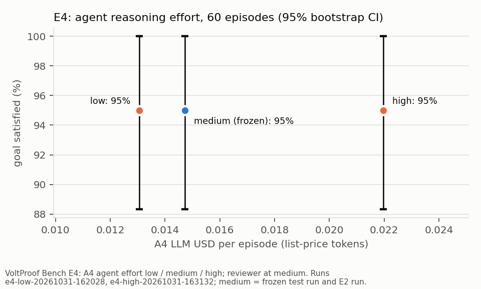

# VoltProof Bench E4: reasoning-effort sweep

Plan: 60 episodes (30 main, 30 hard), plan sha256 `94a5e7d6f2b6`. Only the A4 agent's reasoning effort varies (its own turns, repairs included); the reviewer stays at medium. Medium = the stored A4 rows of the frozen test run and the E2 run for the same episodes (not re-run). E4 LLM cost of the two runs: $2.01 billed.

Reported on its own, never pooled with any other run. Fixed in advance: the demo and every other result stay at medium, whatever E4 shows (it is the configuration that was benchmarked). Reasoning-effort sweep suggested by the Fireworks workshop at this hackathon.

Limitation: "actual" weather is the same-day ICON analysis, not a measurement, so forecast error is understated.

### E4: A4 by reasoning effort and subset

| subset | effort | episodes | goal satisfied | spec exact match | plan physics valid | repair rounds mean (0/1/2) | escalations / fallbacks | ended at the turn cap | billed USD / episode | token USD / episode | median latency s | p90 latency s | agent reasoning tokens / episode | length stops | cached calls |
| --- | --- | --- | --- | --- | --- | --- | --- | --- | --- | --- | --- | --- | --- | --- | --- |
| main | low | 30 | 100.0% | 100.0% | 100.0% | 0.23 (23/7/0) | 0 / 0 | 0 | 0.0118 | 0.0123 | 9.5 | 14.4 | 288 | 0 | 8 |
| main | medium | 30 | 100.0% | 96.7% | 100.0% | 0.17 (25/5/0) | 0 / 0 | 0 | 0.0117 | 0.0137 | 8.0 | 13.5 | 716 | 0 | 37 |
| main | high | 30 | 100.0% | 100.0% | 100.0% | 0.20 (24/6/0) | 0 / 0 | 0 | 0.0176 | 0.0179 | 13.9 | 19.8 | 1514 | 0 | 6 |
| hard | low | 30 | 90.0% | 96.7% | 100.0% | 0.20 (24/6/0) | 0 / 0 | 0 | 0.0132 | 0.0139 | 10.6 | 14.7 | 436 | 0 | 14 |
| hard | medium | 30 | 90.0% | 96.7% | 100.0% | 0.30 (22/7/1) | 0 / 0 | 0 | 0.0143 | 0.0158 | 11.1 | 16.5 | 951 | 0 | 22 |
| hard | high | 30 | 90.0% | 93.3% | 100.0% | 0.37 (20/9/1) | 0 / 0 | 2 | 0.0245 | 0.0260 | 15.8 | 32.7 | 2868 | 0 | 14 |
| all | low | 60 | 95.0% | 98.3% | 100.0% | 0.22 (47/13/0) | 0 / 0 | 0 | 0.0125 | 0.0131 | 10.3 | 14.6 | 362 | 0 | 22 |
| all | medium | 60 | 95.0% | 96.7% | 100.0% | 0.23 (47/12/1) | 0 / 0 | 0 | 0.0130 | 0.0147 | 9.9 | 14.4 | 833 | 0 | 59 |
| all | high | 60 | 95.0% | 96.7% | 100.0% | 0.28 (44/15/1) | 0 / 0 | 2 | 0.0210 | 0.0220 | 14.6 | 23.3 | 2191 | 0 | 20 |

Billed USD is what the ledger charged; token USD prices every token at list price (runner.token_usd), because some medium rows were partly served from the LLM cache. Comparisons and the figure use token USD. Latency: medium was measured in other runs, at another time and concurrency (2, vs 1 here), so latency differences are indicative only. Agent reasoning tokens exclude the reviewer.

### Paired bootstrap 95% CIs (10,000 resamples, seed 2026): each effort minus medium

| measure | comparison | main | hard | all |
| --- | --- | --- | --- | --- |
| goal satisfied | low - medium | +0.0 pts [+0.0, +0.0] (0 of 30 episodes differ) | +0.0 pts [+0.0, +0.0] (0 of 30 episodes differ) | +0.0 pts [+0.0, +0.0] (0 of 60 episodes differ) |
| goal satisfied | high - medium | +0.0 pts [+0.0, +0.0] (0 of 30 episodes differ) | +0.0 pts [+0.0, +0.0] (0 of 30 episodes differ) | +0.0 pts [+0.0, +0.0] (0 of 60 episodes differ) |
| spec exact match | low - medium | +3.3 pts [+0.0, +10.0] (1 of 30 episodes differ) | +0.0 pts [+0.0, +0.0] (0 of 30 episodes differ) | +1.7 pts [+0.0, +5.0] (1 of 60 episodes differ) |
| spec exact match | high - medium | +3.3 pts [+0.0, +10.0] (1 of 30 episodes differ) | -3.3 pts [-10.0, +0.0] (1 of 30 episodes differ) | +0.0 pts [-5.0, +5.0] (2 of 60 episodes differ) |

One sample per setting: run-to-run LLM variation is not measured, so a difference of one or two episodes is reported as such, not as an effect.

### hard_impossible: shortfall stated in the explanation (the E2 report's check)

| effort | episodes | shortfall stated | spec exact match | no explanation (no accepted finalize) |
| --- | --- | --- | --- | --- |
| low | 3 | 3/3 | 2/3 | 0 |
| medium | 3 | 3/3 | 2/3 | 0 |
| high | 3 | 1/3 | 1/3 | 1 |

The check looks for the shortfall of the gold spec's plan on the forecast (A5). An explanation that states the shortfall of a differently read spec (e.g. a 100% reserve over [0, 24), which also constrains the starting charge) does not count; an episode that ended without an accepted finalize has no explanation.
